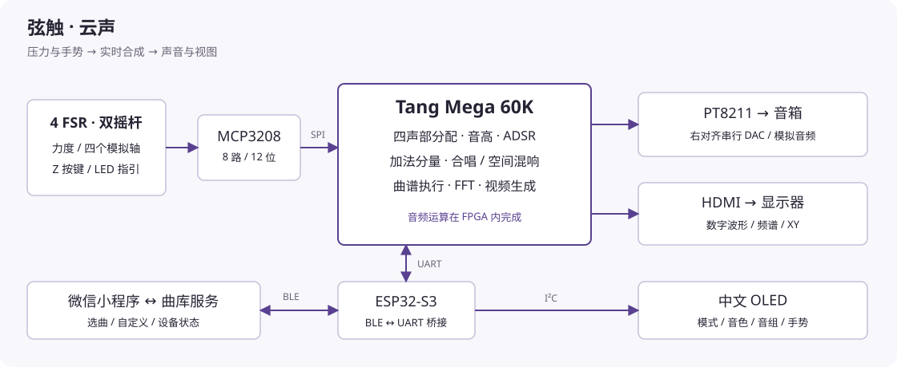

# 弦触·云声 · XianChu

**用压力和手势演奏的 FPGA 实时合成乐器。**

四片压力传感器负责触发与力度，双摇杆控制滑音、颤音、谐波明暗和空间效果。声音在 Tang Mega 60K 内实时运算；ESP32-S3 负责蓝牙与中文 OLED，微信小程序负责选曲和设备控制。



## 能做什么

| 部分 | 当前实现 |
|---|---|
| 演奏 | 四声部独立音高、包络与力度；拨弦、吹管、钟声、合成贝斯四种音色；两组音符及高八度切换 |
| 表情 | J1 X 滑音、J1 Y 颤音；J2 X 调节 2–32 个加法分量及明暗，J2 Y 调节当前效果湿度 |
| 效果 | 合唱/延迟与 FDN 空间混响两类效果；释放后保留音色包络尾音 |
| 练习 | 自由、引导、挑战三模式；四 LED 提示目标区域，引导等待正确输入，挑战按节奏计数 |
| 显示 | 中文 OLED 显示模式、音色、音组与手势；FPGA 直接输出 HDMI 数字波形、FFT 与 XY 图 |
| 手机 | BLE 配对、状态与声部显示、自定义键位、曲库下载、设备端曲谱合成试听 |
| 调试 | 可选浏览器串口状态台、GAO 探针、离线波形/延迟分析及原生协议测试 |

音频输出采用板载 **PT8211 的右对齐串行格式**，不是标准 Philips I²S。手机传输的是曲谱与控制事件，**不把本系统当作蓝牙音箱传输 PCM 音乐**。每声部最多 32 个谐波分量也不等于 32 键复音：可同时演奏的声部数是 4，高音区会限制超出抗混叠边界的分量。

## 快速开始

1. 准备 Tang Mega 60K 与 NEO Dock、MCP3208 调理板、四 FSR、双摇杆、四 LED、ESP32-S3 N16R8 和 SSD1306 128×64 I²C OLED。先看 [完整接线表](docs/hardware.md)。
2. 从 [Releases](https://github.com/cty050422/xianchu-fpga/releases) 下载同一版本的固件包。FPGA 使用 `fpga/XianChu.fs`，S3 推荐打开包内 Arduino 工程上传。详细设置见 [构建与烧录](docs/build.md)。
3. 松开 FSR、摇杆回中，**按住 Z2，按一下 FPGA KEY2，再松开 Z2**。等待 OLED 显示可演奏状态；KEY1 不能代替 KEY2。首次试听从小音量开始。
4. 在微信开发者工具导入 `src/wechat_miniprogram`，填入你自己的小程序 AppID；真机预览连接蓝牙。项目内的 `touristappid` 仅用于源码浏览，不能代替你自己的真机权限。见 [小程序与演奏操作](docs/usage.md)。
5. 在线曲库需要电脑启动服务，手机与电脑处于可互通网络：

```sh
# 安装 Node.js 24 LTS 后，在项目根目录执行；曲库本身无需 npm install。
npm start
# Windows 也可双击 start_catalog.cmd。
```

在小程序“设备”页保存终端打印的电脑局域网地址（默认端口 **8893**），点击“检查连接”。手机不能用 `127.0.0.1` 访问电脑。开发预览的 HTTP 请求需要微信调试设置；正式发布需要配置 HTTPS 合法域名。

## 常用操作

| 操作 | 作用 |
|---|---|
| FSR 1–4 | 分别触发四个区域；改变压力调节该声部力度 |
| 单击 Z1 / 双击 Z1 | 切换音组 / 切换原八度与高八度 |
| 单击 Z2 / 双击 Z2 | 切换音色 / 切换自由、引导、挑战模式 |
| 长按 Z2 约 1 秒 | 已有曲谱时开始、暂停或继续练习 |
| 同时按住两个 Z 键 | 停止当前演奏并回到自由状态 |

两只摇杆均按 **+X 向下、−X 向上、+Y 向右、−Y 向左** 装配。曲谱需要先下载成功；没有曲谱时不能启动引导/挑战。完整操作、空曲谱与断线排查见 [使用说明](docs/usage.md)。

## 源码与复现

```text
src/
  rtl/                    合成、交互、效果、FFT 与显示逻辑
  gowin/narrative/         器件、引脚、时序约束与 GAO 配置
  firmware/arduino/        配套 ESP32-S3 Arduino 工程
  wechat_miniprogram/      微信小程序
  catalog_service/        当前产品使用的轻量曲库服务
  assistant_gateway/      曲库共享模块及可选音频/语音研究代码
  performance_ui/         可选浏览器串口诊断台
tests/                    RTL、跨端协议与数值分析测试
tools/                    构建、检查和发布入口
docs/                     接线、构建、操作、架构与协议
third_party/              开放字库许可及来源
```

```sh
python tools/check_project.py
npm ci --prefix src/assistant_gateway --ignore-scripts
npm test
python tools/test_cpp.py
# 下列检查需要另行安装 Icarus 与 Gowin 原语库：
python tools/run_rtl.py
```

[架构与算法](docs/architecture.md) · [通信协议](docs/protocol.md) · [测试范围](docs/testing.md) · [已知限制](docs/limitations.md) · [发布说明](CHANGELOG.md)

本仓库发布的是完整源码与配套构建产物；每次发行的测试摘要、文件哈希与硬件验收范围随 Release 提供。数字仿真、STA 与真实 DAC/扬声器测量分别记录，不互相替代。

## English

XianChu is an expressive four-voice musical instrument built on the Gowin Tang Mega 60K. Audio synthesis, per-voice envelopes, additive partials, effects, FFT and video generation run in FPGA logic. An ESP32-S3 provides a BLE control bridge and a Chinese OLED interface; a WeChat mini-program downloads symbolic scores and displays device state. This is a synthesizer, not a Bluetooth PCM speaker. See [build instructions](docs/build.md) and [hardware pin mapping](docs/hardware.md).

## 许可

原创代码采用 [MIT](LICENSE)。Sipeed、Gowin、Adafruit、Noto 字形及外部依赖保留各自许可，见 [NOTICE](NOTICE.md)。设备界面采用开放授权字库，可使用仓库脚本重新生成。
